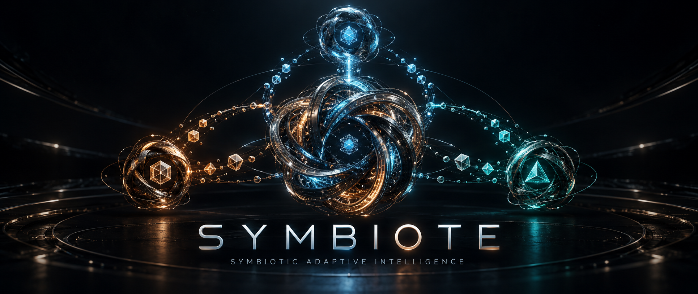

<p align="center">
  
</p>

# SYMBIOTE

**Symbiotic Adaptive Intelligence**

A Rust-native intelligence that reasons from evidence, learns through authorized
exchange, and returns useful knowledge to its partners. Its identity and validated
experience persist between runs. No language model or API key is required for the
local demonstrations.

[](https://github.com/jacksonjp0311-gif/SYMBIOTE/actions/workflows/ci.yml)
[](https://github.com/jacksonjp0311-gif/SYMBIOTE/releases)
[](Cargo.toml)

[Get started](#get-started) · [How it works](#how-it-works) ·
[Evidence](#evidence-and-limits) · [Roadmap](docs/ROADMAP.md) ·
[Operations](docs/OPERATIONS.md) · [Local qualification](docs/LOCAL_QUALIFICATION_V051.md)

> **Research preview — v0.5.1.** The [24-cycle local qualification passed](docs/LOCAL_QUALIFICATION_V051.md)
> with real TLS, retained models, reviewed rotation, a killed service and verified
> restore. This is one PC and two fixed fixtures. Two-host validation and
> long-term reliability remain open. The [v0.5 primary remains HOLD](docs/RESEARCH_V05_PRIMARY_HOLD.md);
> its engineering reproduction completes all 192 cases, with the fixed-peer
> control still cheaper. Stable v1.0 and better partner selection are not established.

## Get started

Download or clone this repository. The release installers select your platform,
verify the downloaded archive against its SHA256 manifest, and install a standalone
binary. Release installation does not need Rust, Python, or a model service.

**Windows — PowerShell**

```powershell
git clone https://github.com/jacksonjp0311-gif/SYMBIOTE.git
cd SYMBIOTE
.\tools\install.ps1 -Version v0.5.1 -AddToPath
symbiote doctor
symbiote demo
```

**Linux or macOS — from the checkout**

```sh
sh tools/install.sh --version v0.5.1
~/.local/bin/symbiote doctor
~/.local/bin/symbiote demo
```

Installers require the matching binary bundle on the
[release page](https://github.com/jacksonjp0311-gif/SYMBIOTE/releases). If a bundle
has not been published for your version or architecture, build from source:

```sh
cargo install --path crates/symbiote-runtime --locked
symbiote demo
```

You can also download a matching archive directly, extract it, and run
`symbiote demo` from its directory (`.\symbiote.exe demo` on Windows). See
[installation and recovery](docs/OPERATIONS.md) for paths and platform details.

## Use it

```sh
symbiote demo       # Watch the original two-agent learning cycle
symbiote status     # Inspect retained identity and knowledge
symbiote predict    # Use retained models without network requests
symbiote doctor     # Inspect readiness without changing local state
```

Output is readable by default. Add `--json` for scripts and complete receipts.
Use `--state PATH` to keep independent experiments separate, and `--receipts FILE`
to choose the report destination. Default local state is `state/demo`; generated
reports are written under `experiments/local/`. Both are ignored by Git.

Run `demo` twice to observe retained knowledge being rechecked and reused. Run
`status` or `predict` to inspect and use the retained state. Optional experiments
exercise the broader native system:

| Command | What it runs |
| --- | --- |
| `symbiote research` | Structural learning, verified exchange and isolated controls |
| `symbiote graph-research` | Paired routing tasks; prints a command for retained `route` queries |
| `symbiote network-research` | Two native peer processes with private state and actual restart |
| `symbiote adaptive-research --reproduce` | Full controlled study; allow about 20 minutes, with a 30-minute cap |

Route queries return a conditional certificate or an explicit abstention. To run
supervised peers over TLS, follow the
[identity and credential guide](docs/TLS_DEPLOYMENT.md). The
[configured knowledge service](docs/SERVICE.md) supports explicitly granted
queries and quarantined offers over operator-provisioned TLS. Local evaluation
controls promotion. `symbiote --help` lists every command and option.

Start with `demo`. The full adaptive study owns its local peer processes,
writes fresh temporary state and preserves all
failed or unfinished cases. A recorded setup can be restored for reproducible
control comparisons; it imports no learned knowledge or private keys.

To preserve a stopped owner, use `backup-state`, `verify-backup` and
`restore-state` with its separately saved manifest checksum. The
[backup recipe](docs/OWNER_BACKUPS.md) keeps identity, evaluated knowledge and
receipts together. A configured service additionally needs explicit
[restore approval or certificate rotation](docs/SERVICE_LIFECYCLE.md); copying a
configuration does not activate restored state.

From a Windows checkout, the single entrypoint also supports:

```powershell
.\SYMBIOTE-All-One.ps1 -Run
.\SYMBIOTE-All-One.ps1 -Research
.\SYMBIOTE-All-One.ps1 -GraphResearch
.\SYMBIOTE-All-One.ps1 -AdaptiveResearch
.\SYMBIOTE-All-One.ps1 -NetworkResearch
.\SYMBIOTE-All-One.ps1 -Doctor
.\SYMBIOTE-All-One.ps1 -Verify
```

## How it works

**SENSE → MODEL → CONNECT → EXCHANGE → VERIFY → LEARN → CONTRIBUTE → REASSESS**

SYMBIOTE treats observations, conditional inferences and unverified hypotheses as
different kinds of information. A received strategy cannot become trusted merely
because a partner supplied it or because it matches a few examples.

1. **Sense and model.** Read authorized structured telemetry and maintain exact
   hypothesis support. Structural reasoning selects queries that maximize
   worst-case elimination of surviving explanations within its declared family.
2. **Exchange and verify.** Negotiate explicit capabilities, scope and resource
   limits. Check received observations against the separate synthetic oracle
   registry before replaying them into the receiver's unrestricted learner.
3. **Learn durably.** Promote evaluated declarative models into a versioned ledger
   with identity, applicability, provenance and evidence. Corruption or an
   unsupported claim fails explicitly.
4. **Contribute and reassess.** Offer useful knowledge to the partner, which retains
   adoption authority. Counterexamples revoke invalidated knowledge without
   deleting its history.

The structural experiment uses two separate learning algorithms: exact hypothesis
enumeration and Gaussian elimination over binary observations. It evaluates
unobserved inputs across configured widths 3–8 and seeds 7, 19, 43 and 101.
Transferred observations supply evidence; hints never silently restrict the
candidate family or authorize a prediction.

The local protocol provides mutual authentication, revocation, sequence checks,
bounded JSONL frames and request budgets. It is scoped to trusted loopback use;
the native process experiment uses that same explicit loopback protocol.
A separate [TLS 1.3 API](docs/SECURITY.md) supplies mutual certificate validation,
name/pin identity binding and resource-limited encrypted sessions for configured
library integrations. The supervised runtime can use this transport with explicit operator credentials;
its integration tests use real TLS on loopback. Nonlocal deployment remains a
separate evidence gate.

The native process experiment keeps each peer's identity and ledgers separate
from the controller. Real process restarts use stored models, with actual oracle
counters required to stay zero during retained prediction. [Deployment](docs/DEPLOYED_AGENTS.md)
and [memory lifecycle](docs/MEMORY_LIFECYCLE.md) document supervision, copied-identity
rejection, crash recovery, immutable backups and byte-preserving migration.

## Evidence and limits

| What is checked | Evidence |
| --- | --- |
| Original BRUTE algorithm preserved exactly | [Byte-identical Python reference](docs/reference/brute/symbolic.py) and [parity receipt](experiments/parity.json): 6,093 cases, 20,843 checkpoints |
| Original two-agent learning and restart | [Genesis verification](experiments/genesis-verification.json), including rejection, drift, rollback and newer-revision recovery |
| Structural learning, held-out predictions and exchange controls | [Reciprocal exchange receipt](experiments/v0.2/reciprocal-exchange.json) and [v0.2 verification](experiments/v0.2/verification.json) |
| Native processes, retained prediction, recovery and migration | [v0.3 software gates](experiments/v0.3/software-verification.json), [deployment verification](experiments/v0.3/deployed-verification.json) and [native exchange receipt](experiments/v0.3/native-process-exchange.json) |
| Complete graph cohort, conditional routes and durable graph learning | [v0.4 graph verification](experiments/v0.4/graph-verification.json), [raw paired cases](experiments/v0.4/graph-exchange.json), and [experiment protocol](docs/RESEARCH_V04_PROTOCOL.md) |
| Native adaptive relationships, exact setup replay and honest controls | [v0.5 engineering verification](experiments/v0.5/engineering-verification.json), [preserved primary HOLD](experiments/v0.5/primary-verification.json), and [methods/results](docs/RESEARCH_V05.md) |
| v0.5.1 local maintenance and continuity | [S5 qualification](docs/LOCAL_QUALIFICATION_V051.md) and [evidence index](experiments/v0.5.1/README.md): 24 TLS cycles, reviewed rotation, denial/regrant, lost reply, owned crash and verified relocation |
| Authentication, budgets, integrity and failure recovery | Native unit/integration tests and [cross-platform CI](https://github.com/jacksonjp0311-gif/SYMBIOTE/actions/workflows/ci.yml) |
| Scientific interpretations and failed criteria | [Research findings](docs/RESEARCH.md) and [roadmap](docs/ROADMAP.md) |

The v0.5.1 default software gate passed **292 Rust test executions, 53 Python
tests and 6,093 parity cases**. A separately selected ignored test completed the
24-cycle continuity check; 16 named regression repeats are existing tests, not
new tests or independent samples. S5 took 83.969 seconds with 66 root commands.
The earlier S3 and S4 checker failures remain **HOLD**, even though S4's native
phase passed. The same two fixtures, two owners and two evaluated models were
used throughout; this is narrow local recovery evidence, not long-term or
two-host qualification. [Full account](docs/LOCAL_QUALIFICATION_V051.md).

Genesis increased prediction coverage from 32/64 to 64/64 on repeated four-input
tasks; its equal-probe-budget control also reached 64/64. This does not establish
a sample-efficiency advantage for exchange.

The structural experiment studies reuse of authenticated observations under a
trusted synthetic oracle registry and an explicit cost model. Any reciprocal
benefit is limited to those conditions. Acquisition cost is counted for both
participants; exchanged evidence, verification, adoption and predictions also have
declared costs. The learners, oracle implementations and evaluation logic are
separate software components, not independent research teams. Conditional
agreement within an affine family does not prove that an arbitrary external
agent belongs to that family. Repeated laws or predictions must not be counted
as independent discoveries.

The [affine](docs/RESEARCH_V02.md) and [routing](docs/RESEARCH_V04.md) studies
include conditional benefits, cheap-observation controls, harmful exchanges and
withheld predictions. They retain their original formulas, evidence and limits.
Declared participant costs exclude laboratory overhead and establish no general
efficiency or wall-clock advantage.

The v0.5 engineering reproduction runs five native learner roles across four
controls and two prices on the same 24 unfamiliar graphs. It retains two complete
graph contexts and replays 21 predictions per active learner with zero evaluator
requests. Its 64 stored promotions are repetitions across private control profiles.
Normal A+B1 logical cost falls from 110,119 to 107,380 versus isolation; the fixed
control costs 107,176. Cheap-observation exchange costs more than isolation.
Partner scores change, but this trace shows no changed actions from those scores.
The first primary remains HOLD; complete evidence and failed criteria are
[published together](experiments/v0.5/README.md). No wall-clock speedup is claimed.

Stable v1.0 requires broader independent environments, demonstrated reciprocal
benefits after all costs, secure external connections, robust persistent memory
and a documented failure envelope. Version numbers advance after the evidence.
The [release gates](docs/STABLE_RELEASE_GATES.md) record which local lifecycle
checks passed and which deployment, duration and scientific criteria remain open.

## Architecture

Four substantive Cargo crates keep reasoning, authorization, learning and runtime
behavior explicit without fragmenting the system into placeholder packages.

| Path | Responsibility |
| --- | --- |
| `crates/symbiote-reasoning/` | Exact hidden-state and affine inference, conservative graph certificates, active queries and conditional prediction |
| `crates/symbiote-protocol/` | Authorized local sessions, separate TLS 1.3 API, resource limits, sensors and revocation |
| `crates/symbiote-memory/` | Private identity, evaluated knowledge, operational journals, idempotency, rollback and lifecycle integrity |
| `crates/symbiote-runtime/` | Native peers, configured knowledge service, active learning, experiments and isolated controls |
| `docs/` | Architecture, mathematics, operations, provenance, research and version objectives |
| `docs/assets/` | Original project artwork and its provenance |
| `docs/reference/` | Preserved upstream algorithm used by developer parity checks |
| `experiments/` | Compact checked receipts; local generated runs stay ignored |
| `tests/fixtures/` | Shared original-Python/native fixtures |
| `tools/` | Installers, verification, packaging and upstream audit utilities |
| `SYMBIOTE-All-One.ps1` | Synchronous Windows build, run, research, test, verify and Git operations |

[Architecture](docs/ARCHITECTURE.md) · [Compatibility](docs/COMPATIBILITY.md) · [Reasoning](docs/REASONING.md) ·
[Protocol](docs/PROTOCOL.md) · [Operations](docs/OPERATIONS.md)

## Develop and verify

Stable Rust and Cargo build the native system. Python 3.11+ is needed only for
developer verification against the original Python implementation.

```sh
cargo test --workspace --locked
cargo clippy --workspace --all-targets --locked -- -D warnings
python tools/verify.py
```

`Cargo.lock` pins dependencies. Verification reports failures and preserves the
distinction between software correctness, measured fixture outcomes and broader
research claims. [Changelog](CHANGELOG.md).

## Foundation and attribution

SYMBIOTE is a clean derivative of
[BRUTE](https://github.com/jacksonjp0311-gif/Brute/tree/9edbc035792ca75d3a3333b8454e5bf31c706eb1),
pinned at `9edbc035792ca75d3a3333b8454e5bf31c706eb1` from its v0.11.0 era.
BRUTE's selected symbolic algorithm is retained unchanged. Its full SP8/SAT
certification policy is not claimed ported, and its failed sound-transfer gates
remain documented. AEFL contributes independently adapted bounded telemetry and
drift concepts; similarity is not a learning criterion.

All 983 upstream files are classified in the
[migration manifest](docs/upstream-manifest.json). Original repositories,
authorship and scientific evidence remain untouched and accessible through
pinned links. Historical archives and massive generated results stay upstream.

The active tracked tree is about 5.94 MB across 14 root entries, versus BRUTE's
574.80 MB and 41 entries: about 98.97% fewer bytes. [Footprint](experiments/footprint.json)
excludes Git history, build caches and local state. Full study traces live in
checksum-pinned release assets.

New SYMBIOTE code uses the [MIT license](LICENSE). The retained BRUTE reference
has an explicit exception because the inspected upstream supplied no license
declaration; its original rights are preserved. See
[full provenance](docs/PROVENANCE.md) and [artwork provenance](docs/assets/README.md).
