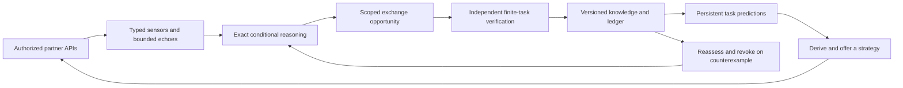

# SYMBIOTE

**Symbiotic Adaptive Intelligence — v0.1.0 Genesis**

An independent Rust process that develops persistent, evaluated knowledge through
authorized reciprocal interactions. SYMBIOTE descends from BRUTE's exact bounded
reasoning work and keeps its own identity and knowledge ledger. It runs without a
language model or the Python BRUTE application.

This is a working research preview on small deterministic laboratory tasks.
It demonstrates scoped reasoning, verified learning, retained predictions and
independently accepted return strategies. General intelligence, general transfer
benefits and autonomous self-improvement remain unverified.

## Run

Install stable Rust with Cargo. No API keys, model service or Python are needed
for the runtime. The demo creates two explicitly authorized loopback TCP endpoints.

```powershell
.\SYMBIOTE-All-One.ps1 -Build -Run
cargo run --locked -p symbiote-runtime --bin symbiote -- predict --state state/demo
cargo run --locked -p symbiote-runtime --bin symbiote -- demo --state state/demo
.\SYMBIOTE-All-One.ps1 -Test -GitStatus
.\SYMBIOTE-All-One.ps1 -Verify
.\SYMBIOTE-All-One.ps1 -Benchmark
```

`predict` is a separate process: it loads retained knowledge and identity and
makes no network requests. A subsequent `demo` reuses both artifacts, rechecks
their applicability against four probes per partner and makes no new promotions.
`-Verify` additionally needs Python 3.11+ for the original-reference parity check;
use `-Python PATH` if Python is not on PATH. Linux/macOS: `cargo test --workspace
--locked`, then `python tools/verify.py`. Default demo state lives under ignored
`state/`; benchmarks use fresh ignored directories. [Detailed commands](docs/OPERATIONS.md).

## Architecture

The cognitive cycle is SENSE → MODEL → CONNECT → EXCHANGE → VERIFY → LEARN →
CONTRIBUTE → REASSESS. An initial authenticated connection supplies the first
telemetry; later cycles use the resulting model to identify exchange opportunities.



Four substantive crates keep boundaries clear without placeholder packages.
The exact hidden-state estimator and the evaluated finite-table predictor are
distinct representations. A conditional prediction from BRUTE's declared model
family is never a universal claim about an arbitrary agent.

| Directory/file | Responsibility |
| --- | --- |
| `crates/symbiote-reasoning/` | Exact Moore-machine prefix version space, support projection, contradiction and budget abstention |
| `crates/symbiote-protocol/` | Mutual authorization, API versioning, budgets, revocation, telemetry sensor interfaces and bounded echoes |
| `crates/symbiote-memory/` | Exhaustive finite-task evaluation, promotion gates, durable identity, versioned knowledge and rollback ledger |
| `crates/symbiote-runtime/` | Independent process, two simulated services, reasoning/learning loop, strategy extraction and controls |
| `docs/` | Architecture, mathematics, provenance, operations, research and roadmap |
| `docs/reference/` | Byte-identical BRUTE algorithm used by developer parity checks |
| `experiments/` | Small actual Genesis receipts, parity evidence and cost accounting |
| `tests/fixtures/` | Shared original-Python/native reasoning fixtures |
| `tools/` | Reproduction, upstream classification and verification tools |
| `SYMBIOTE-All-One.ps1` | Build, run, test, verify, benchmark and visible Git operations |

## Observed capabilities

The default two-agent experiment starts with two observed inputs out of four per
partner. It builds an exact hidden-state hypothesis space, detects missing task
knowledge, receives untrusted tables, checks every finite input through the
authorized API, and promotes only correct knowledge that improves prediction
coverage without regression. It then derives an XOR or second-bit strategy from
the checked table. Each partner independently validates that strategy before use.

| Measurement | Actual result |
| --- | --- |
| SYMBIOTE isolated partial-model predictions | 32/64 correct; 32 abstentions |
| After evaluated exchange | 64/64 correct; 0 abstentions |
| Same four-probe-budget control, without requesting an exchange artifact | 64/64 correct |
| Verification cost | 8 SYMBIOTE probes + 8 separate control probes + 8 partner checks |
| Partner cost, each 32-task batch | 176 → 72 declared resource units, including 4 verification calls |
| Restart | Same identity; 2 artifacts reused; 0 new promotions |
| Incorrect knowledge | Rejected; no promotion; later valid candidate accepted |
| Changed environment | Counterexample detected; affected artifact durably revoked |
| Exact Python/Rust reasoning parity | 6,093 cases; 20,843 checkpoints; 0 mismatches |
| Native unit/integration tests | 33 passed; strict Clippy and formatting passed |

These are four-input fixtures repeated across 32 predictions per partner, not
64 independent research samples. An abstention is not an incorrect certificate.
The partner cost model assigns 1 unit to a local prediction and 10 to an oracle
call; it is not a measured CPU speedup. The matched-probe control also learns the
whole table: **this release establishes no sample-efficiency advantage for
exchange**. [Research findings and receipts](docs/RESEARCH.md).

## Provenance and scientific status

BRUTE main is pinned at `9edbc035792ca75d3a3333b8454e5bf31c706eb1`, release
v0.11.0 at `d8b449d45931145ae9b177a88de3833f54301479`.
The source of the exact port, `bgr90/symbolic.py`, is preserved byte-for-byte.
Full BRUTE SP8/SAT certification-policy parity is not claimed. BRUTE's failed
sound-transfer gates remain explicitly documented and its original evidence
remains upstream. AEFL contributes independently adapted bounded-buffer and
drift concepts; increased similarity is never a learning metric.

Every one of the 983 upstream files is classified in the
[migration manifest](docs/upstream-manifest.json). BRUTE's active upstream tree
contains 548.17 MiB and 41 root entries; SYMBIOTE's active tracked files occupy
less than 0.5 MiB with 14 root entries, reducing bytes by over 99.9% and root
entries by 65.85%. It excludes massive result payloads, duplicate version layout
and generated material. [Measured footprint](experiments/footprint.json). Original repositories
are untouched. Neither inspected upstream supplies a license declaration; the
reference retains its original rights and is excluded from the MIT license for
new SYMBIOTE code. [Full provenance](docs/PROVENANCE.md).

## Milestones

v0.1 Genesis delivers the complete first operational vertical slice, including
limited prototypes of later objectives. Version advancement requires new
evidence, not the existence of infrastructure.

Next: v0.2 First Symbiosis should test independently implemented partners,
hold-out task families and real exchange opportunities, then compare both agents
against matched-cost isolated learners. Persistent storage and rollback already
exist, but generalized adaptive memory and networked relationships remain future
work. [Version objectives and acceptance criteria](docs/ROADMAP.md).
