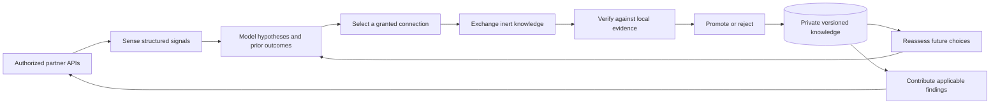

# Native cognitive architecture

SYMBIOTE keeps its own identity, evidence and learned knowledge. Partners supply
candidate information; local reasoning and evaluation decide what it can retain.
The runtime works without a language model.

## Four crates, distinct decisions

| Crate | Its decision |
| --- | --- |
| `symbiote-reasoning` | Which exact hypotheses survive, whether a prediction is conditionally certified, and which permitted observation to request |
| `symbiote-protocol` | Whether a mutually authenticated session and operation fit the identities, scopes, frame limits, deadlines and budgets |
| `symbiote-memory` | Whether evidence warrants a fresh durable promotion, supersession or revocation, and whether stored history remains consistent |
| `symbiote-runtime` | Which authorized cognitive action or experiment to take, how to execute it within limits, and how to return useful information |

The configured [cognitive runtime](LIVE_RUNTIME.md) is the operational path.
The transfer, topology and exploration commands are controlled research runners.
Research controllers never grant access to unrelated endpoints.

## Three kinds of state

1. **Observed:** typed telemetry, published capabilities and actual protocol
   outcomes. A successful RPC establishes a transport/application outcome.
2. **Inferred:** exact finite-family support, graph cost intervals, and fallible
   rankings of useful peers, query roles or experiments. A ranking is a prior,
   not an observation or a certificate.
3. **Validated:** declarative task knowledge and strategies accepted by explicit
   local evidence and regression checks. Only fresh accepted changes count as
   learning. Replayed receipts do not count again.

BRUTE's Moore-machine algorithm remains byte-preserved in the reference tree
and is ported with shared-fixture parity. Native affine and positive weighted
graph models extend the useful bounded representations. There is no universal
certification of arbitrary agents or unrestricted programs.

## Persistent adaptation

The owner identity and hash-linked histories are separate from partner identity.
Knowledge and strategy ledgers preserve provenance, applicability, evidence,
promotions and revocations. Knowledge anchors bind an exact historical prefix;
a decision cannot claim an old promotion as new improvement.

The query strategy is an inert ranking of graph edge roles learned from exact
source observations. It can change which unknown edge the exact solver asks
about. It cannot add a fact, narrow the solver's hypothesis space, or authorize a
prediction. Counterexamples can revoke the policy while valid observed graph
facts remain useful. Held-out retention and query-policy utility are measured
separately.

Outcome-conditioned experiment selection reserves the whole declared cost before
admission. Its bounded information estimate and empirical history determine a
deterministic ranking; unique fresh local promotion evidence determines any
credited gain. Matched-budget controls test whether exchange supplied a benefit
beyond observations the learner could acquire itself.

## Connections and contributions

Configured peers require explicit identity, certificate pin, mutual grants,
scope and operation permissions. Connection failure, denial, partial delivery and
uncertain delivery remain distinct outcomes. Revocation persists through restart.
Three-peer research uses receiver-side edge checks and exact custody receipts;
an intermediate sender cannot invent a previous successful hop.

The runtime may offer a locally validated model to another compatible partner.
Acceptance into quarantine is delivery evidence. The receiving owner keeps
evaluation and adoption authority. Benefits to the sender and receiver are
reported separately; a negative total cost result stays negative.

## Failure envelope

All native work has finite admission limits. Socket deadlines do not preempt
arbitrary trusted native callbacks; embedding hosts must honor the documented
deadline and cancellation contract. Plaintext application counters do not include
TLS cryptographic wire overhead. Hash chains detect inconsistent history under
the declared file-owner boundary; privileged rewriting of both state and an
independent external pin is outside it.

Writers are exclusive, unsupported formats fail closed, and backup/restore
requires an independently retained manifest digest. New strategy-bearing owners
use explicit layout registration and byte-preserving migration. Older readers
must reject unfamiliar typed events rather than erase them.

The qualification scope is the authorized PC and declared task families.
Independent two-host behavior, arbitrary task transfer, unattended credential
management and general intelligence remain open research or deployment work.
