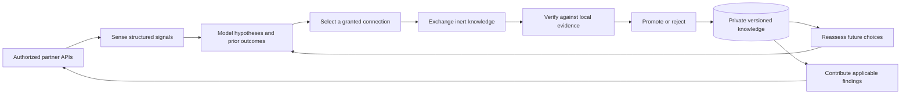

# Native cognitive architecture

SYMBIOTE keeps its own identity, evidence and learned knowledge. Partners supply
candidate information; local reasoning and evaluation decide what it can retain.
The runtime works without a language model.

## Four crates, distinct decisions

| Crate | Its decision |
| --- | --- |
| `symbiote-reasoning` | Which exact hypotheses survive, whether a prediction is conditionally certified, and which permitted observation to request |
| `symbiote-protocol` | Whether a mutually authenticated session and operation fit the identities, scopes, frame limits, deadlines and budgets |
| `symbiote-memory` | Whether evidence warrants a fresh durable promotion, supersession or revocation, and whether stored history remains consistent |
| `symbiote-runtime` | Which authorized cognitive action or experiment to take, how to execute it within limits, and how to return useful information |

The configured [cognitive runtime](LIVE_RUNTIME.md) is the operational path.
The transfer, topology and exploration commands are controlled research runners.
Research controllers never grant access to unrelated endpoints.

Inside the existing runtime crate, responsibilities are separated into
`service/selection.rs` (semantic inventory and durable proposal history),
`service/evaluation.rs` (local independent validation), `service/observation.rs`
(active evidence acquisition), `service/feedback.rs` (causal measurement and
replay), `service/outcomes.rs` (opt-in receiver-owned processing and witnessed
outcomes), `service/timing.rs` (bounded diagnostics), and `service/cognitive.rs`
(finite orchestration). No additional crates or external model dependency are
required. The exact compact affine implementation lives beside its enumerating
reference in the reasoning crate.

Unreleased main adds exact cached operational prefix hashes and an ordered
feedback-startup cursor, while preserving the original hash bytes and reference
algorithms. Optional rank-basis query selection reduces work within the same
bounded affine family. The independent-observer embedding talks to a separate
authorized source process, freezes a validated model, and reopens it for fresh
predictions with the source stopped. This embedding is separate from the normal
configured receiver channel. [Measured results and limits](ENGINE_EVOLUTION_002.md)
keep component costs, retained exchange use and fresh source reuse distinct.

## Typed embedding engine target

The v1.1.0 candidate adds `symbiote_runtime::engine::Engine` inside the existing
runtime crate. [Its public embedding contract](ENGINE_EMBEDDING.md) supplies typed
configuration, observation adapters, errors, event sinks, bounded episodes,
independent evaluation, retention, prediction, revocation and checkpoint/restore.
The façade owns its stores and journal privately; a caller cannot turn a success
flag or supplied digest into a promotion. Source callbacks remain trusted native
code and must cooperate with cancellation and deadlines. The initial public
embedding boundary is the exact affine family, rather than every research API.

Each new engine owner registers a required writer capability immediately after
its original identity genesis. Explicit compatible engine constructors admit it;
generic and earlier writers refuse it. Unmarked prototype owners are held rather
than upgraded. The [compatibility guide](COMPATIBILITY.md) explains downgrade and
snapshot rollback limits. The marker is metadata, not a learned model.

Local transfer connects two actual, host-owned `Engine` handles under a bilateral
grant for the exact artifact, source epoch, scope and policies. The receiving
engine independently evaluates before retention and records later model use and
its outcome. Reconciliation reads that actual receiver's checked journal and
current active knowledge. A saved response cannot substitute for the receiver
handle or re-credit a completed exchange. Historical response snapshots stay
auditable after revocation; their remote-current status is explicitly unknown
until another live check. Conditional capability and unknown economic benefit
remain distinct. This local API does not widen configured network permissions.

Typed counters derive disjoint ordinary and receiver promotion origins from exact
committed episodes and native knowledge anchors. Reuse is separate, and capability
or measured-benefit counts are subsets. Historical completion survives later
revocation; current active/source/policy validity is reported separately.
`Engine::resources()` exposes per-instance knowledge I/O and journal prefix work
without another source call or file read. Its byte stages overlap and are not a
whole-process CPU, peak-memory or economic-gain measurement.

Knowledge publication pins the exact opened bytes, including accepted JSON
whitespace, and rechecks them before staging and replacement. Changed, missing or
foreign history holds instead of being overwritten from a cache. Added guard
reads and hashing are metered. Exact capacity failures and actual storage failures
have separate typed categories. Existing receipt bytes, durable publication order
and capacity limits remain intact. A post-commit sink failure reports the actual
committed anchor; it cannot undo learning. These checks assume cooperative local
writers and do not promise an adversarial filesystem compare-and-swap or power-loss
durability. [The v1.1 status](V11_ENGINE_STATUS.md) keeps pending qualification
separate from implemented interfaces and component checks.

## Three kinds of state

1. **Observed:** typed telemetry, published capabilities and actual protocol
   outcomes. A successful RPC establishes a transport/application outcome.
2. **Inferred:** exact finite-family support, graph cost intervals, and fallible
   rankings of useful peers, query roles or experiments. A ranking is a prior,
   not an observation or a certificate.
3. **Validated:** declarative task knowledge and strategies accepted by explicit
   local evidence and regression checks. Only fresh accepted changes count as
   learning. Replayed receipts do not count again.

BRUTE's Moore-machine algorithm remains byte-preserved in the reference tree
and is ported with shared-fixture parity. Native affine and positive weighted
graph models extend the useful bounded representations. There is no universal
certification of arbitrary agents or unrestricted programs.

## Persistent adaptation

The owner identity and hash-linked histories are separate from partner identity.
Knowledge and strategy ledgers preserve provenance, applicability, evidence,
promotions and revocations. Knowledge anchors bind an exact historical prefix;
a decision cannot claim an old promotion as new improvement.

The query strategy is an inert ranking of graph edge roles learned from exact
source observations. It can change which unknown edge the exact solver asks
about. It cannot add a fact, narrow the solver's hypothesis space, or authorize a
prediction. Counterexamples can revoke the policy while valid observed graph
facts remain useful. Held-out retention and query-policy utility are measured
separately.

Outcome-conditioned experiment selection reserves the whole declared cost before
admission. Its bounded information estimate and empirical history determine a
deterministic ranking; unique fresh local promotion evidence determines any
credited gain. Matched-budget controls test whether exchange supplied a benefit
beyond observations the learner could acquire itself.

## Connections and contributions

Configured peers require explicit identity, certificate pin, mutual grants,
scope and operation permissions. Connection failure, denial, partial delivery and
uncertain delivery remain distinct outcomes. Revocation persists through restart.
Three-peer research uses receiver-side edge checks and exact custody receipts;
an intermediate sender cannot invent a previous successful hop.

The runtime may offer a locally validated model to another compatible partner.
Acceptance into quarantine is delivery evidence. The receiving owner keeps
evaluation and adoption authority. Benefits to the sender and receiver are
reported separately; a negative total cost result stays negative.

The [unreleased receiver channel](RECEIVER_OUTCOMES.md) adds a separately granted
read-only `outcome.read` operation. An opt-in local receiver policy evaluates a
quarantined contribution and uses the resulting model for its own declared goal.
The sender verifies complete bounded ledger witnesses, binds the exact exchange
and current policy epoch, then persists a once-only reconciliation. Remote polling
cannot authorize evaluation or execute transferred instructions. The initial
envelope is one peer/context and retained affine use; operator fixture authority
remains an assumption. Outcome and capability counters do not imply economic
benefit when costs are unknown.

## Value of an exchange

`symbiote_reasoning::symbiosis` scores one participant at a time:

`U = expected_gain - transfer_cost - verification_cost - regression_risk`

The eight decisions are Connect, Observe, RequestKnowledge, OfferKnowledge,
Experiment, Defer, Abstain and Disconnect. Abstain is the result when no
operator grant is present. A decision never creates a grant. Knowledge is
requested or offered only for RequestKnowledge and OfferKnowledge. Connect
recommends a relationship and requires authorization on both views; it does not
send a payload. An unqualified gain is observation, not a utility of zero.
Qualified zero defers. A remote participant with negative utility also defers,
even when the local score is positive. The cognitive runtime plans this before
`candidate.submit`. The current affine and graph fixtures do not beat their
isolated check bounds, so those submissions are not sent.

`symbiote_memory::reciprocal` seals a receiver-originated receipt. Schema
`symbiote.reciprocal-evaluation/2` binds a SHA-256 digest over the canonical
body. That digest is not benefit. On corrected main, benefit is true only when
`confirmed_benefit(store, witness)` reseals against the actual receiver
ledger. `seal_promoted`
finds a completed promotion between the receiver's validated anchors, the
active payload for that scope changed, and the stored exchange total is
strictly below the stored isolated baseline. Those facts are copied from the
ledger. A content digest, a declined value plan, and a receipt resealed
against a different owner stay false. Identical payloads from another source
add provenance without changing the capability set, and the sender must match
the promoted record's source. `persisted_after_restart` is informational only.
`retained_benefit_after_store_reopen` actually opens an existing stopped ledger
and requires that exact promoted record to remain active. This is store replay,
not proof of an OS restart. Mutual success requires both independently witnessed
directional receipts, crossed identities and crossed initial knowledge anchors
through `witnessed_mutual_research_success`. Legacy unchecked helper signatures
are deprecated and return false; they cannot establish evidence.
The [release audit](V1_RELEASE_AUDIT.md) documents defects in the published
v1.0.0 predicates; main fixes do not change those binaries or establish a
generalized reciprocal-learning result.

The corrective candidate's bound feedback path additionally ties the exact
decision and offered artifact to the evaluation, promotion, later prediction
and one-time outcome. It preserves measured, estimated and unknown baselines,
actual local task-window costs and independent participant evidence. Retained
harmful and favorable outcomes inform bounded future source selection.
[Corrective measurement contract](CORRECTIVE_RELEASE_101.md).

The configured cognitive episode emits `VALUE` before any contribution payload
and reconciles that prediction with whether a payload was sent. Its summary
still reports `partner_benefits_verified` as 0. A quarantine is delivery, not
benefit. A caller-supplied net cannot flip `benefit_verified`.

An optional normal capability goal can select a partial graph certificate for
a pinned fresh target absent from the recipient's compatible knowledge union.
The recipient independently validates transferred facts and retains adoption
authority. Useful capability and positive economic benefit are separate
outcomes. This opt-in does not manufacture an economic estimate for either peer
and does not weaken the old full-fixture utility test.

A width-3 enumeration of all 16 affine truths finds that a true hint and a
wrong hint both take the same 4 oracle queries as independent maximin and the
fixed basis. Support is unchanged by the hint. The cycle therefore defers and
both receipts deny benefit. This is a mechanism result inside the information
bound of that family. It is not evidence that a richer transferable structure
is impossible, and it is not a rerun of the frozen query-policy cohort.

## Failure envelope

All native work has finite admission limits. Socket deadlines do not preempt
arbitrary trusted native callbacks; embedding hosts must honor the documented
deadline and cancellation contract. Plaintext application counters do not include
TLS cryptographic wire overhead. Hash chains detect inconsistent history under
the declared file-owner boundary; privileged rewriting of both state and an
independent external pin is outside it.

Writers are exclusive, unsupported formats fail closed, and backup/restore
requires an independently retained manifest digest. New strategy-bearing owners
use explicit layout registration and byte-preserving migration. Older readers
must reject unfamiliar typed events rather than erase them.

The qualification scope is the authorized PC and declared task families.
Independent two-host behavior, arbitrary task transfer, unattended credential
management and general intelligence remain open research or deployment work.
